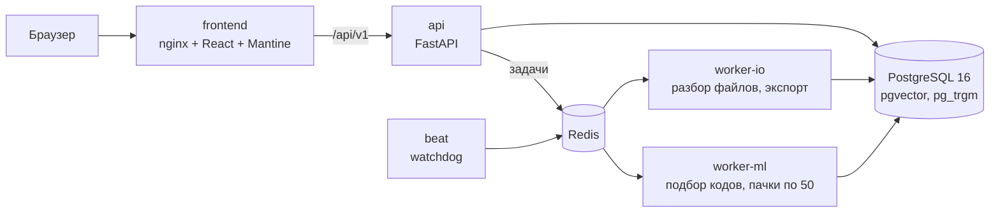

# AI-классификатор КТРУ

Сервис подбирает коды КТРУ для позиций закупки. Вы загружаете спецификацию (xlsx, csv, pdf), система извлекает из
текста атрибуты товара и для каждой позиции предлагает три кода КТРУ с уверенностью в процентах и пояснением, какие
характеристики совпали. Уверенные позиции принимаются одним действием, спорные проверяет человек, результат
выгружается в исходном формате.

Проект сделан для кейс-чемпионата B2B-РТС, задача 5 «ИИ-классификатор КТРУ».

**Видео-демонстрация** (4 мин 32 с): [`video/KTRU_demo.mp4`](video/KTRU_demo.mp4). (ссылка на Google Disk:https://drive.google.com/drive/folders/1TG3IhU1YDXHF5Bo2JN_6STvTzq-Nk16z?usp=drive_link)


## Содержание

- [Возможности](#возможности)
- [Быстрый старт](#быстрый-старт)
- [Как пользоваться](#как-пользоваться)
- [Работа через API](#работа-через-api)
- [Как это устроено](#как-это-устроено)
- [Качество](#качество)
- [Настройки](#настройки)
- [Разработка и тесты](#разработка-и-тесты)
- [Структура репозитория](#структура-репозитория)
- [Данные](#данные)
- [Документация](#документация)
- [Команда](#команда)

## Возможности

| Что нужно по кейсу | Как реализовано |
| --- | --- |
| Извлечение атрибутов | Наименование, бренд, модель и характеристики из свободного текста; видны в карточке позиции |
| Точность классификации | Два шага: категория ОКПД2, затем позиция КТРУ со сверкой характеристик |
| 1000 позиций быстрее 5 минут | Пачки по 50 позиций в отдельной очереди; на 2 ядрах CPU 70–212 с на 1000 позиций |
| Уверенность в процентах | Откалиброванная вероятность у каждой позиции; зоны green, yellow, red |
| Ручная корректировка | Поиск по каталогу, выбор кода, причина, отмена за 5 секунд; решение запоминается |
| Очередь задач | Celery + Redis, ответ API сразу, прогресс и оценка времени, отмена |
| Запуск одной командой | `docker compose up --build`, только CPU, ключи LLM не нужны |

Дополнительно: сгруппированные одинаковые позиции («+N таких же»), сортировка «Сначала неуверенные», массовое
подтверждение выше порога, выгрузка в исходный файл, Excel, CSV или JSON, быстрая проверка до 20 строк без задачи,
оценка качества на размеченных наборах прямо из интерфейса, загрузка новой версии каталога через API без перезапуска.
Авторизации нет: сервис рассчитан на локальный запуск.

## Быстрый старт

Нужны Docker с Compose, 8 ГБ оперативной памяти и около 4 ГБ на диске. Интернет нужен при сборке и первом запуске.

```bash
git clone https://github.com/Leshyyyy/ktru.git
cd ktru
cp .env.example .env
docker compose up --build
```

Когда запуск закончится, откройте:

- интерфейс — http://127.0.0.1:8080;
- API — http://127.0.0.1:8000/api/v1 (проверка готовности — `GET /api/v1/health`, поле `ready`).

Порты задаются переменными `WEB_PORT` и `API_PORT` в `.env`. На Windows порт 8000 иногда занят системой, тогда
поставьте, например, `API_PORT=18000`.

Что происходит при первом запуске:

1. **Сборка, около 10 минут.** В образ ML-воркера ставится torch (сборка для CPU) и скачивается модель эмбеддингов
   `intfloat/multilingual-e5-small` (около 470 МБ, ревизия и хеши закреплены).
2. **Первый старт, ещё несколько минут.** Контейнер `migrate` скачивает каталог КТРУ (открытый датасет ЕИС, ревизия
   и sha256 закреплены) и загружает его в базу. ML-воркер один раз считает эмбеддинги каталога в pgvector. Пока он
   готовится, интерфейс показывает «Система готовится».
3. **Следующие запуски ничего не скачивают.**

Без доступа к Hugging Face при первом запуске система не падает: она работает на заглушке с кодами `99.99.*`, а
причину показывает `GET /api/v1/health`. Когда доступ появится, запустите `docker compose up` ещё раз.

Для быстрой проверки без скачивания поставьте в `.env` `PIPELINE=stub`: заглушка ML на маленьком каталоге, удобно для
работы над фронтендом и бэкендом.

Тестовые спецификации для проверки лежат в `tests/fixtures/`: `specification_100.xlsx` (100 позиций, обрабатывается
быстро) и `specification_1000.xlsx` (1000 позиций, для проверки скорости). Реальные документы из извещений —
в `tests/fixtures/real_specs/`.

## Как пользоваться

1. **Загрузка.** Перетащите файл на страницу «Подбор кодов КТРУ». Система покажет листы и предпросмотр строк.
2. **Роли колонок.** Система предлагает роли сама (наименование, описание, характеристики, количество, единица).
   Проверьте их, особенно колонку наименования, и нажмите «Начать обработку». Ответ приходит сразу, вкладку можно
   закрыть: задача живёт в очереди.
3. **Результаты.** У каждой позиции есть код КТРУ и уверенность в процентах. Включите «Сначала неуверенные», чтобы
   проверка начиналась с сомнительного. Одинаковые позиции сгруппированы, бейдж «+N таких же» экономит время.
4. **Карточка позиции.** Извлечённые атрибуты, три кандидата, сверка характеристик (совпало, не совпало, обязательные
   отмечены), пояснение к первому и причины, почему остальные не первые.
5. **Правка.** «Найти другой код в каталоге», выбор позиции, при желании причина, «Сохранить код». Для такого же
   текста в следующий раз подставится подтверждённый код. Случайное действие отменяется за 5 секунд.
6. **Подтверждение и выгрузка.** «Подтвердить все от 70%» (порог зелёной зоны) затрагивает только уверенные позиции, система покажет их
   число. «Выгрузить» отдаёт файл как исходный, Excel, CSV или JSON; если остались непроверенные позиции, система
   предупредит.

Остальные экраны: «Задачи» (очередь и история) и «Качество» (метрики на размеченных наборах). В шапке видно, сколько
кодов загружено в каталог. Макеты и описание интерфейса — в `docs/team/`.

## Работа через API

Полное описание — `contracts/openapi.yaml` (префикс `/api/v1`). Swagger включается переменной `API_DOCS=true` и
открывается на `/api/v1/docs`. Ошибки всегда в одном формате: `{"error": {"code", "message", "details"}}`, поле
`message` по-русски. Для примеров ниже нужны `curl` и `jq`.

```bash
API=http://127.0.0.1:8000/api/v1
curl -s $API/health | jq .ready        # true: модели и каталог загружены, можно создавать задачи

# 1. Загрузить файл: в ответе листы, предпросмотр и предложенные роли колонок
curl -s -F "file=@tests/fixtures/specification_100.xlsx" $API/files | tee file.json \
  | jq '.sheets[] | {name, row_count, header_row, columns: [.columns[] | {index, header, suggested_role}]}'
FILE=$(jq -r .file_id file.json)
HEADER_ROW=$(jq -r '.sheets[0].header_row' file.json)

# 2. Создать задачу: ответ 202 приходит сразу, файл разбирается в очереди.
#    Роли подставьте по ответу шага 1: ровно одна колонка name, остальные characteristics, quantity, unit или ignore.
curl -s -X POST $API/jobs -H 'Content-Type: application/json' -d '{
  "file_id": "'"$FILE"'", "header_row": '"$HEADER_ROW"',
  "column_mapping": [{"index": 0, "role": "name"}, {"index": 1, "role": "characteristics"},
                     {"index": 2, "role": "quantity"}, {"index": 3, "role": "unit"}]
}' | tee job.json | jq '{job_id, status}'
JOB=$(jq -r .job_id job.json)

# 3. Прогресс: опрашивать раз в 1–2 секунды, пока статус queued, parsing или processing
curl -s $API/jobs/$JOB | jq '{status, total_items, processed_items, progress, eta_seconds, summary}'

# 4. Позиции (доступны и во время обработки); sort=confidence_asc поднимает наверх спорные
curl -s "$API/jobs/$JOB/items?sort=confidence_asc&page_size=10" \
  | jq '.items[] | {row_index, raw_text, status, band, final: .final.ktru_code}'

# 5. Решения: подтвердить код, указать свой, подтвердить всё не ниже порога
ITEM=$(curl -s "$API/jobs/$JOB/items?page_size=1" | jq -r '.items[0].item_id')
curl -s -X POST $API/items/$ITEM/confirm | jq '{status, final}'
curl -s -X POST $API/jobs/$JOB/confirm-bulk -H 'Content-Type: application/json' -d '{"min_confidence": 0.70}'

# 6. Выгрузка: format = source | xlsx | csv | json; число непроверенных позиций — в заголовке X-Unreviewed-Count
curl -s -o result.xlsx "$API/jobs/$JOB/export?format=xlsx"

# 7. Быстрая проверка до 20 строк без задачи
curl -s -X POST $API/classify -H 'Content-Type: application/json' \
  -d '{"items": [{"text": "Бумага офисная А4, 80 г/м2, 500 листов"}, {"text": "Картридж HP 85A"}]}' \
  | jq '.results[] | {text, code: .predictions[0].ktru_code, confidence: .predictions[0].confidence}'
```

Поиск по каталогу, оценка качества, статистика, отмена и удаление задач, загрузка новой версии каталога описаны
в `backend/README.md` (все команды проверены на запущенном стеке).

## Как это устроено



| Часть | Что делает | Владелец |
| --- | --- | --- |
| `frontend/` | React 19, TypeScript, Vite, Mantine, TanStack Query: загрузка, роли колонок, таблица позиций, карточка кода, выгрузка | Таир |
| `backend/` | FastAPI, PostgreSQL 16 + pgvector, Celery (очереди `io` и `ml`), Alembic | Данил |
| `backend/files/` | Разбор xlsx, csv, pdf и экспорт | Донир |
| `ml/` | Подбор кода КТРУ (ниже) | Jove |
| `contracts/` | Источник правды: `openapi.yaml`, `schema.sql`, `ml_contracts.py`, `stub_pipeline.py` | все |
| `docs/` | Системная аналитика (Sphinx) | Егор |

Контракты важнее любого текста: если код или документ расходится с контрактом, прав контракт. Фронтенд, бэкенд и ML
работают по одному `openapi.yaml`, типы фронтенда генерируются из него.

**Асинхронность.** `POST /jobs` отвечает 202 сразу. Файл разбирает `worker-io`, коды подбирает `worker-ml` пачками по
50 позиций, поэтому таймаутов нет даже на больших файлах. Задачи идемпотентны, `predictions` пишутся по ключу
`(item_id, rank)`, зависшие задачи подбирает watchdog в `beat`. Итоговый код позиции читается только через
представление `v_item_final`.

### ML: как выбирается код

Внутри одного кода ОКПД2 позиции КТРУ называются одинаково («Ноутбук», «Шприц») и различаются обязательными
характеристиками, а по тексту КТРУ категорию живого названия товара угадать трудно. Поэтому две ступени:

1. **Категория ОКПД2** — по 106 тыс. реальных карточек товаров портала поставщиков (СТЕ), которым ОКПД2 поставили
   сами поставщики: ближайшие по названию карточки голосуют за свой код.
2. **Позиция КТРУ внутри категории** — поиск по наименованию КТРУ (TF-IDF и нечёткое сравнение) и сверка
   характеристик: числа с единицами («объём 5 мл» против «> 3 и ≤ 5»), значения из списка, да или нет.
3. **Уверенность** — калибратор (логистическая регрессия и изотоническая калибровка): «0,8» означает, что такие
   ответы верны примерно в 80% случаев. Зону считает бэкенд по порогам из `GET /config`: green от 70%, yellow от 50%,
   ниже — red.

Ручные решения сохраняются в `confirmed_examples`; ML принимает их через `add_examples` и для того же текста сразу
отдаёт подтверждённый код. Эмбеддинги наименований (`intfloat/multilingual-e5-small`) дают смысловую близость в
поиске; векторы хранятся в `catalog_items.embedding` (pgvector, `vector(1024)`) и считаются один раз при первом
старте ML-воркера. Подробности и методика — `ml/CLAUDE.md` и `docs/analytics/07-ml.md`.

## Качество

Конфигурация Docker: полный каталог КТРУ (81 461 позиция), эмбеддинги включены, без ключей LLM.

| Набор | Что проверяет | Результат |
| --- | --- | --- |
| **300 строк контрольного набора v3.2** (test, при настройке не использовался) | точный код / любой допустимый / ОКПД2 / эталон в топ-3 | **87%** / 93% / 97% / 93% (требование: не ниже 85%) |
| те же 300 строк | атрибуты / ECE | **97%** / 0,060 (требование к атрибутам: не ниже 90%; цель команды по ECE: не выше 0,05) |
| 700 размеченных строк v3.2 (синтетика по КТРУ) | точный код / любой допустимый | **87,9%** / 93,9% (требование: не ниже 85%) |
| те же 700 строк | ОКПД2 / атрибуты / ECE | 97,1% / 96,2% / 0,031 |
| 78 строк объектов закупки из извещений ЕИС (канцелярия, мебель) | точный код / ОКПД2 / ECE | **83,3%** / 93,6% / 0,096 |
| 1000 реальных названий товаров (СТЕ) | ОКПД2 верный | **75,9%** (простой поиск по КТРУ — 41%) |
| те же и 6 характеристик в строке | ОКПД2 верный | **76,1%** |

Цифры для защиты — первые две строки, контрольный набор: его запускают один раз перед сдачей кнопкой «Контрольный
замер» на странице «Качество» (проценты там округлены вниз до целого). Набор из 700 строк — рабочий, на нём проверяли
правки, поэтому его цифры чуть оптимистичнее. На слайде «Что требовалось и что получилось» в видео — цифры более
раннего замера на рабочем наборе (87,0% и 96,2%); на контрольном наборе это 87% и 97%.

Числовые требования организаторов — точный код, атрибуты и скорость — на контрольном наборе выполнены. Сверх них
команда поставила себе цели с запасом (`docs/analytics/09-data-quality.md`). ECE — насколько заявленные проценты
расходятся с фактической точностью — должна быть не выше 0,05: на рабочем наборе 0,031, на контрольном 0,060. Эталон
в топ-3 — не ниже 95%: на контрольном 93%. Калибратор под контрольный набор не подбирали, иначе тот перестал бы быть
контрольным.

1000 позиций обрабатываются за 70–220 с на 2 ядрах CPU (требование: меньше 300 с), через весь стек в Docker — около 115 с.

Ответы с уверенностью от 0,7 на размеченных строках — около 72% позиций, верны в 99%; на голых названиях товаров —
около 30% позиций, ОКПД2 верен в 91%. Их можно принимать почти не глядя, остальное система отдаёт человеку. Набор из
700 строк синтетический, построен по КТРУ, поэтому его цифры нельзя читать как точность на реальных закупках; для
реальных данных ориентир — строки извещений ЕИС (выборка мала и узка) и названий СТЕ.

Воспроизвести метрики и замеры:

```bash
python -m ml.evaluate --data <разметка.jsonl> --split dev   # метрики ML на размеченном наборе
python tests/benchmark_1000.py                              # замер разбора, пачек и экспорта на 1000 позиций (на заглушке ML)
```

## Настройки

Все переменные и значения по умолчанию — в `.env.example`. Для запуска ничего менять не нужно. Главное:

| Переменная | По умолчанию | Назначение |
| --- | --- | --- |
| `PIPELINE` | `real` | `real` — настоящий ML на полном каталоге; `stub` — заглушка, без скачивания |
| `EMBEDDER_MODEL` | модель e5-small | `-` отключает эмбеддинги: поиск на TF-IDF, меньше памяти |
| `RERANKER` | без LLM | `llm` включает переранжирование через OpenRouter по желанию; ключи не обязательны |
| `WEB_PORT`, `API_PORT` | 8080, 8000 | Порты интерфейса и API |
| `WEB_BIND`, `API_BIND` | `127.0.0.1` | `0.0.0.0` открывает сервис для других машин сети |
| `API_DOCS` | `false` | Swagger на `/api/v1/docs` |
| `UPLOAD_EXTENSIONS` | `xlsx,csv,pdf` | Какие файлы принимает `POST /files` |
| `UPLOAD_TTL_HOURS` | `24` | Через сколько часов удалять файл, по которому так и не создали задачу |
| `LOG_LEVEL` | `INFO` | Логи в JSON с `request_id` и `job_id` |

Пароли PostgreSQL и Redis по умолчанию годятся только для локального запуска: обе службы сидят во внутренней сети
Docker без выхода наружу, а API по умолчанию слушает только `127.0.0.1`. Для общего сервера задайте свои пароли до
первого запуска. Контейнеры работают без прав суперпользователя, с файловой системой только для чтения и без Linux
capabilities.

## Разработка и тесты

```bash
pytest                                                   # тесты бэкенда, ML и разбора файлов
cd frontend && npm ci && npm run dev                     # фронтенд на встроенной имитации бэкенда, :5173
cd frontend && npm run dev:backend                       # фронтенд против настоящего API на :8000
cd frontend && npm run typecheck && npm test             # типы и тесты фронтенда
python -m ml.evaluate --data <разметка.jsonl>            # метрики ML (разметка — в contracts/fixtures/eval/)
sphinx-build -W -b html docs docs/_build/html            # документация
```

Для фронтенда нужны Node.js 20.19+ или 22 LTS. Типы API после правки контракта обновляет `npm run gen:api`.

Правила работы в репозитории:

- каждый работает в папке своей задачи, в соседние только читает;
- `contracts/` меняется отдельным PR с одобрением бэкенда и ML;
- новая логика идёт с тестом, перед слиянием запускаются тесты своей папки;
- секреты только из переменных окружения;
- ML-код в `ml/` не импортирует FastAPI и Celery.

Полные правила — `CLAUDE.md` в корне и в папке каждой части.

## Структура репозитория

```text
contracts/    openapi.yaml, schema.sql, ml_contracts.py, stub_pipeline.py, fixtures/ (каталог-заглушка, разметка)
backend/      FastAPI-приложение (app/, core/), задачи Celery (tasks/), миграции Alembic (migrations/)
backend/files/  разбор xlsx, csv, pdf и экспорт
ml/           конвейер подбора кода, калибровка, оценка качества, модели (models/)
frontend/     React-приложение, nginx, встроенная имитация API (src/mock)
tests/        e2e, нагрузочный замер на 1000 позиций, генерация спецификаций, fixtures/
docs/         аналитика (analytics/), контракты (contracts/), документы команды (team/), Sphinx
tools/eis/    офлайн-утилита сбора разметки из извещений ЕИС (в продукт не входит)
video/        видео-демонстрация
docker-compose.yml, .env.example
```

## Данные

- **Каталог КТРУ** — выгрузка ЕИС, переданная организаторами (на 10.10.2026, изменения до 16.10.2026). Docker пока скачивает
  более ранний снимок той же выгрузки из открытого датасета `dantetemplar/zakupki-dataset` (05.10.2026): отличие —
  43 новых кода и 124 позиции, ставшие архивными.
- **Карточки СТЕ** портала поставщиков Москвы — тот же датасет; использование согласовано в команде. Из них
  обучены модель категорий и словарь марок (`ml/models/`).
- **Размеченные наборы** лежат в `contracts/fixtures/eval/`, их загружает `migrate`.
- **Реальные спецификации** из извещений ЕИС — `tests/fixtures/real_specs/`.

## Документация

Собирается Sphinx из Markdown, контракты подключаются напрямую.

| Раздел | Где |
| --- | --- |
| Цели, границы, допущения | `docs/analytics/01-goals.md` |
| Сценарий, экраны, статусы | `docs/analytics/02-scenario.md` |
| API и асинхронность | `docs/analytics/05-api.md`, `06-async.md` |
| ML, данные, метрики | `docs/analytics/07-ml.md`, `09-data-quality.md` |
| Разбор файлов | `docs/analytics/08-files.md` |
| Требования и матрица приёмки | `docs/analytics/10-nfr.md`, `11-acceptance.md` |
| Архитектура, интерфейс, ТЗ | `docs/team/` |
| Проверка бэкенда руками | `backend/README.md` |

## Команда

| Участник | Зона |
| --- | --- |
| Jove | ML: подбор кода, калибровка, извлечение атрибутов |
| Данил | Бэкенд, база данных, очередь, docker compose |
| Донир | Разбор файлов, экспорт, e2e-тесты |
| Таир | Фронтенд |
| Егор | Данные, разметка, приёмка, README, видео |
